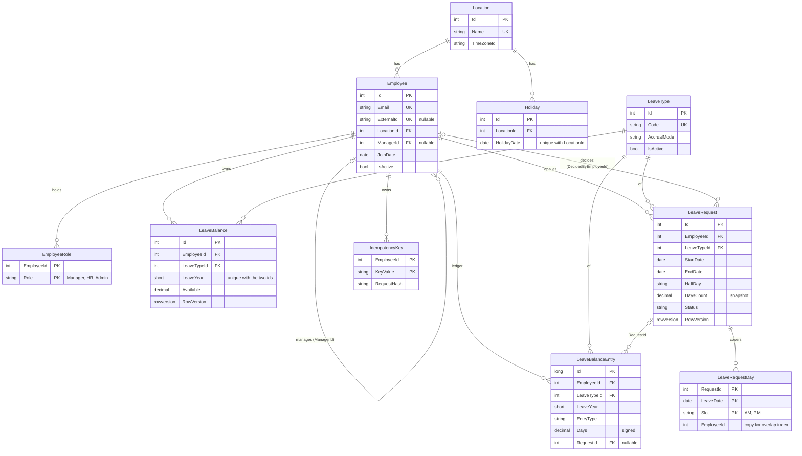
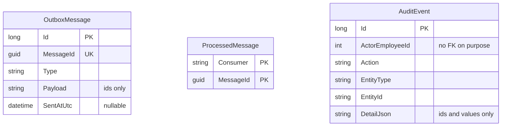

# Data model

Derived from `src\LeaveManagement.Domain` and the EF configurations. Five schemas: `people`, `balances`, `leave`, `notify`, `audit`. Every foreign key is `Restrict` (no cascade, no hard delete). Only key fields and a few important columns are shown.

## Tables with no foreign keys (by design)

## Schema ownership

| Schema | Tables |
| --- | --- |
| `people` | Location, Employee, EmployeeRole |
| `balances` | LeaveType, Holiday, LeaveBalance, LeaveBalanceEntry |
| `leave` | LeaveRequest, LeaveRequestDay, IdempotencyKey |
| `notify` | OutboxMessage, ProcessedMessage |
| `audit` | AuditEvent |

## Rules the database holds

- `LeaveRequestDay` has a composite foreign key `(RequestId, EmployeeId)` to `LeaveRequest` and a unique index on `(EmployeeId, LeaveDate, Slot)` so overlapping leave is impossible.
- `LeaveBalance` is unique per `(EmployeeId, LeaveTypeId, LeaveYear)`; `CK_LeaveBalance_Available` keeps `Available >= 0`.
- `LeaveRequest` checks: `DaysCount > 0`; a half day needs `StartDate = EndDate`; `DecidedAtUtc` is set exactly when `Status` is not `Pending`.
- `LeaveRequest.LeaveYear` is a stored computed column from `StartDate`.
- Enums are stored as text with a `CHECK` constraint.
- Audit and outbox rows hold ids and values, never names, emails or free text.

Checked against the EF configuration code (tables, schemas, keys, foreign keys, unique indexes, check constraints). Not checked: the generated migration SQL, and Mermaid rendering (no renderer available here; preview the file in VS Code or GitHub).
