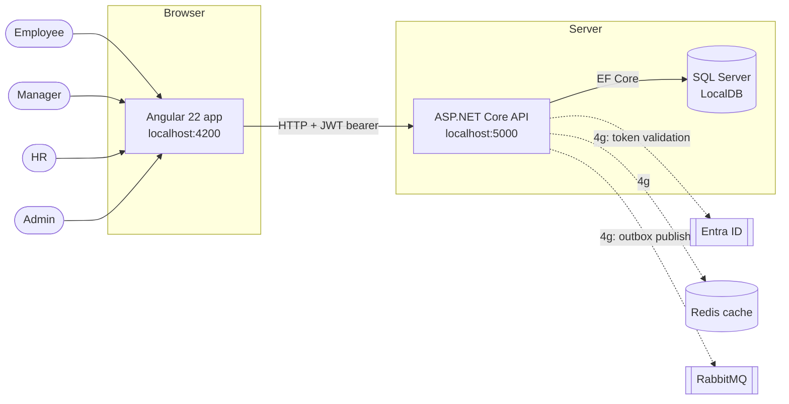

# System context

Who and what talks to whom. Solid lines exist today; dashed lines are planned (increment 4g).

## Notes

- Roles are additive: everyone is an Employee; a person may also be Manager, HR or Admin.
- Auth has one switch (`Auth:Mode` = `Dev` or `EntraId`). Business code never reads it.
- The browser holds the token in memory only.
- CORS allows exactly one origin (the Angular app).
