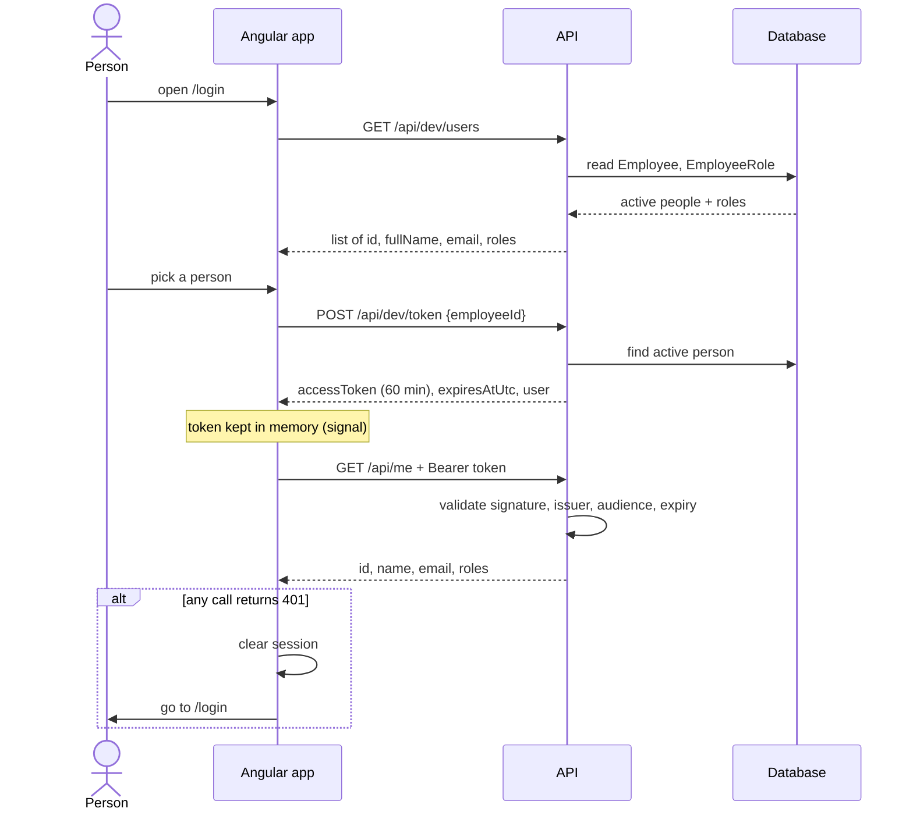

# Dev sign-in flow (spec 4c)

Source: `ai/specs/4c-dev-authentication/design.md` (still a draft). Update both together.

## Token claims

`sub` (employee id), `name`, `email`, `role` (one per role), `iss`, `aud`, `iat`, `nbf`, `exp`. The manager is not in the token; it is looked up.

## Guard rails

- Dev endpoints exist only when `Auth:Mode = Dev`; the API refuses to start in Dev mode outside Development or Demo.
- A fallback policy requires a signed-in user on every endpoint except `/health` and the dev sign-in endpoints.
