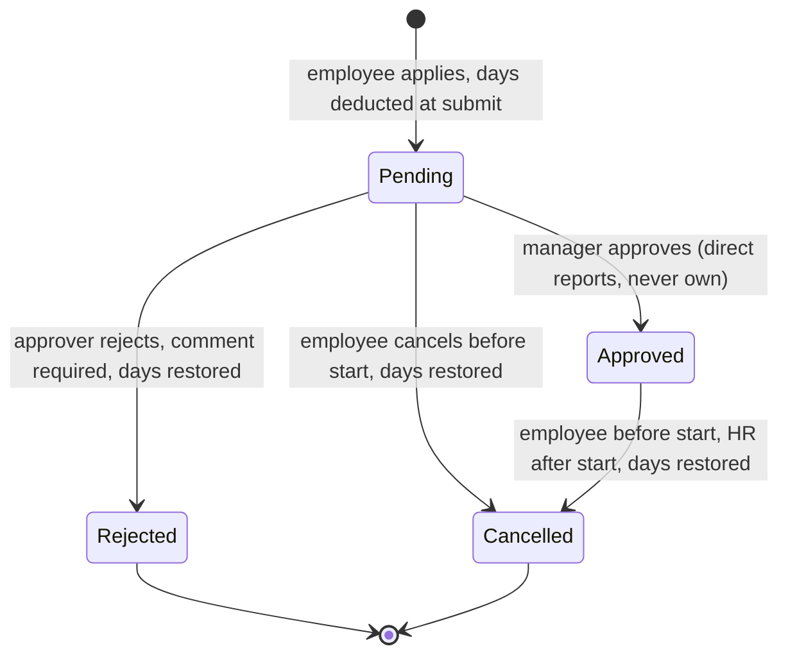
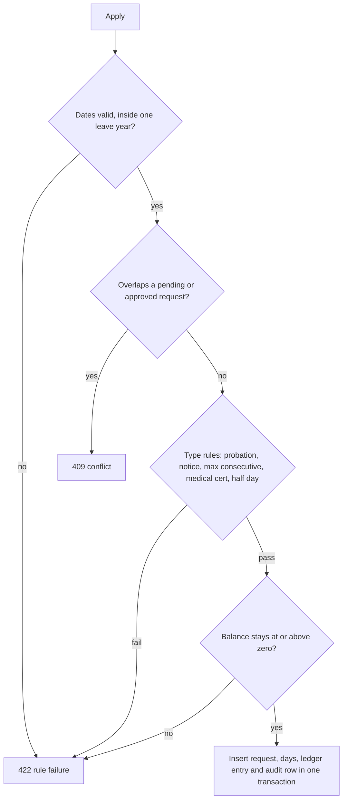

# Leave request lifecycle

States come from `LeaveStatus` (`Pending`, `Approved`, `Rejected`, `Cancelled`). Rules come from the 15 rules in `ai/steering/product.md`. Apply, approve and cancel endpoints arrive in 4d and 4e, so this is intended behaviour, not yet code.

HR approves on behalf when the approver is absent or the person has no manager (rule 14); HR approvals are logged.

## Checks at apply time (server side)

## Facts to remember

- `DaysCount` is a snapshot and is never recalculated.
- The overlap rule is also a unique index on `leave.LeaveRequestDay` (second line of defence).
- Every apply, approve, reject, cancel and balance change writes an audit row in the same transaction.
